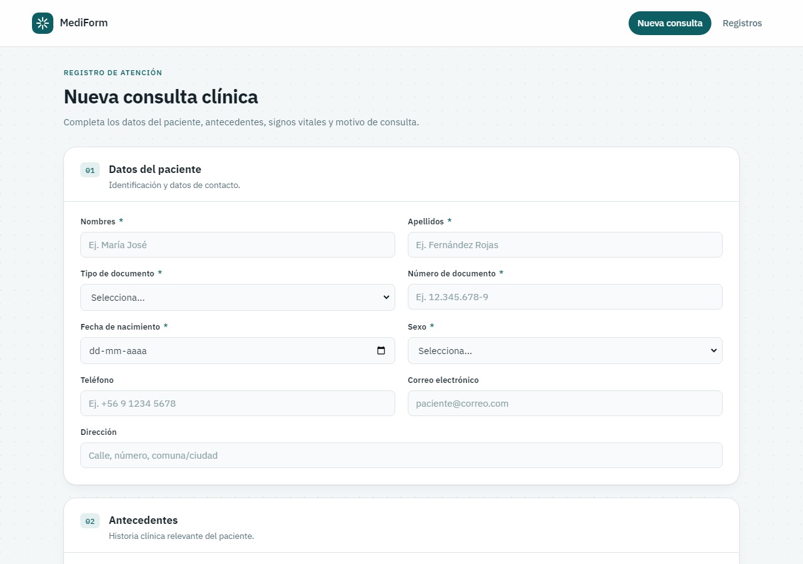
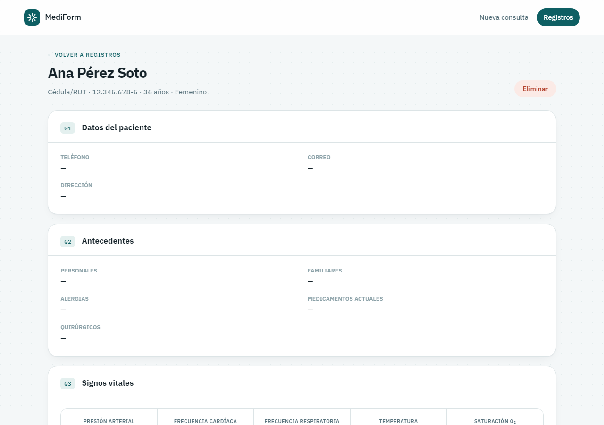

<div align="center">

# 🩺 MediForm

### Formulario clínico digital: Flask + SQLite

[](https://github.com/Fernandamv96/Formulario-Cl-nico-/actions/workflows/ci.yml)
[](https://github.com/Fernandamv96/Formulario-Cl-nico-/actions/workflows/codeql.yml)
[](https://www.python.org/)
[](https://flask.palletsprojects.com/)
[](LICENSE)

</div>

> ⚠️ **Proyecto educativo. No usar con datos clínicos reales.**
> No tiene autenticación y el endpoint `/api/consultas` devuelve todos los registros.

## ¿Qué problema resuelve?

Digitaliza la ficha de una consulta médica: datos del paciente, antecedentes, signos vitales y motivo de consulta. Valida en el cliente y en el servidor, marca los signos vitales fuera de rango y calcula automáticamente la edad y el IMC.



<details>
<summary>Vista de detalle de una consulta (datos ficticios)</summary>



</details>

## Funcionalidades

| | |
|---|---|
| 🗂️ **Formulario por secciones** | Paciente, antecedentes, signos vitales y motivo de consulta |
| ✅ **Validación doble** | En el cliente (feedback inmediato) y en el servidor (fuente de verdad) |
| 💓 **Signos vitales** | Resalta presión, FC, FR, temperatura y saturación fuera de rango |
| 🔍 **Listado con búsqueda** | Por nombre, apellido o número de documento |
| 📋 **Detalle** | Edad e IMC calculados |
| 📱 **Responsive** | Escritorio, tablet y móvil |

## Stack

Python 3.10+ · Flask 3.1 · Flask-WTF (CSRF) · SQLite · Jinja2 · HTML/CSS/JS vanilla · gunicorn · pytest · ruff

## Cómo correrlo localmente

```bash
git clone https://github.com/Fernandamv96/Formulario-Cl-nico-.git
cd Formulario-Cl-nico-
python -m venv .venv && source .venv/bin/activate   # Windows: .venv\Scripts\activate
pip install -r requirements-dev.txt

cp .env.example .env    # y define SECRET_KEY, o expórtala:
export SECRET_KEY="$(python -c 'import secrets; print(secrets.token_hex(32))')"
python app.py           # http://127.0.0.1:5000
```

| Variable | Por defecto | Descripción |
|----------|-------------|-------------|
| `SECRET_KEY` | — (**obligatoria**) | Sin ella la app no arranca, salvo en modo debug, donde usa una clave efímera |
| `FLASK_DEBUG` | `0` | `1` activa el modo debug (solo para desarrollo) |
| `HOST` / `PORT` | `127.0.0.1` / `5000` | Interfaz y puerto de `python app.py` |
| `DATABASE_PATH` | `./clinic.db` | Ruta del archivo SQLite |

Tests y lint:

```bash
pytest
ruff check . && ruff format --check .
```

### Despliegue (Render u otro PaaS)

Build: `pip install -r requirements.txt` · Start: `gunicorn app:app` (ver `Procfile`). Define `SECRET_KEY` en las variables de entorno del servicio. En el plan gratuito el disco es efímero, así que `clinic.db` se reinicia con cada deploy.

## Rutas

| Método | Ruta | Descripción |
|--------|------|-------------|
| GET | `/` | Formulario de nueva consulta |
| POST | `/guardar` | Guarda la consulta (requiere token CSRF) |
| GET | `/consultas` | Listado (`?q=` para buscar) |
| GET | `/consultas/<id>` | Detalle |
| POST | `/consultas/<id>/eliminar` | Elimina (requiere token CSRF) |
| GET | `/api/consultas` | Listado JSON (sin autenticación: solo para la demo) |

## Seguridad

- **CSRF** con Flask-WTF en todos los formularios POST.
- **Headers**: Content-Security-Policy (sin scripts inline), `X-Content-Type-Options`, `X-Frame-Options: DENY` y `Referrer-Policy`.
- **SQL parametrizado** (`?`) en todas las consultas, con un test de inyección.
- **Configuración segura por defecto**: debug apagado, host `127.0.0.1` y `SECRET_KEY` obligatoria.
- CI con ruff + pytest, CodeQL, Dependabot y gitleaks (pre-commit).

Para reportar vulnerabilidades, mira [SECURITY.md](SECURITY.md).

## Estructura del proyecto

```
├── app.py                 # Rutas, validación, SQLite y headers de seguridad
├── templates/             # base, form, list, detail (Jinja2)
├── static/css/style.css
├── static/js/validation.js
├── tests/                 # pytest: creación, validación, CSRF, headers, config
├── requirements.txt       # producción (versiones fijadas)
├── requirements-dev.txt   # + pytest y ruff
└── Procfile               # gunicorn app:app
```

## Qué aprendí

- A validar en dos capas sin confiar nunca solo en el cliente.
- Por qué CSRF importa aunque no haya login, y cómo probarlo con pytest.
- Que una CSP estricta obliga a sacar los `onsubmit="..."` inline a JavaScript.
- Que `debug=True` con `host="0.0.0.0"` expone la consola interactiva de Werkzeug a toda la red.
- A escribir tests que aíslan la base de datos con `tmp_path`.

## Roadmap

- [ ] Autenticación del personal y proteger `/api/consultas`
- [ ] Editar registros (hoy solo se pueden ver y eliminar)
- [ ] Paginación del listado
- [ ] Migración a PostgreSQL

## Licencia

[MIT](LICENSE) © 2026 Fernanda (Fernandamv96)
